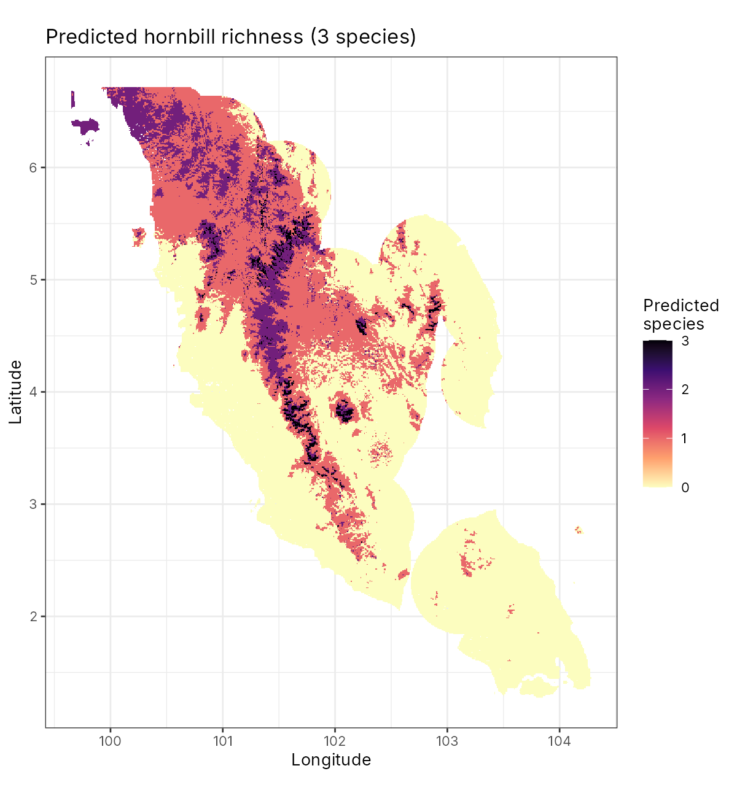
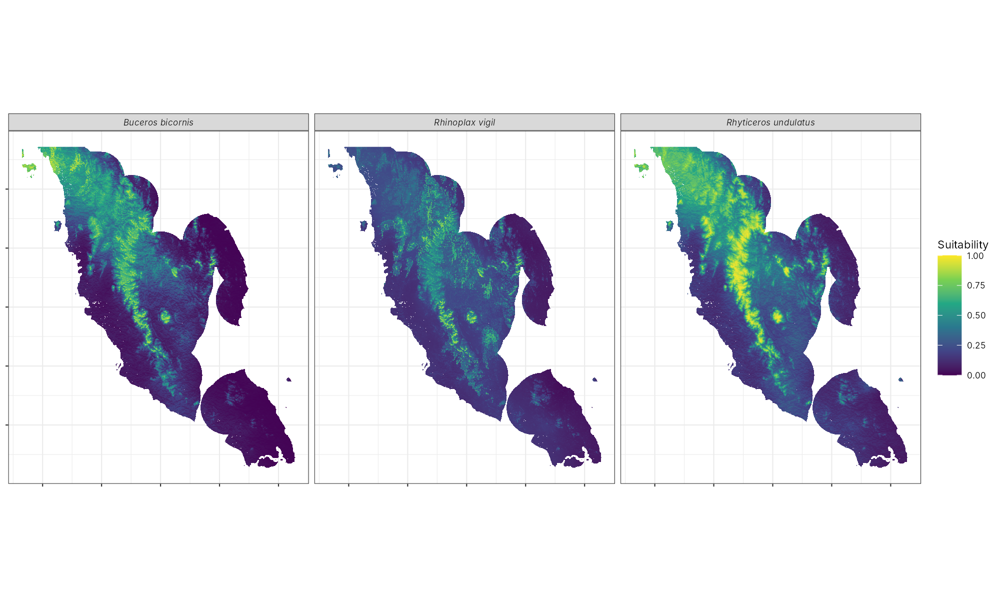

# Hornbill distribution and richness in Peninsular Malaysia

Species distribution models for hornbills in Peninsular Malaysia from GBIF records and 1 km climate and terrain layers. Each species is tested with random and spatial block cross-validation, and only species whose models hold up under spatial validation are mapped and stacked into a richness map.



## Result

Seven species had 25 or more records after thinning. Only three passed the spatial block test (mean AUC of at least 0.7 for at least one model type).

| Species | Records (thinned) | AUC, random CV | AUC, spatial block CV | Mapped |
|---|---|---|---|---|
| *Buceros bicornis* (great hornbill) | 34 | 0.865 | 0.744 | yes |
| *Rhinoplax vigil* (helmeted hornbill) | 28 | 0.768 | 0.722 | yes |
| *Rhyticeros undulatus* (wreathed hornbill) | 33 | 0.758 | 0.669 | yes |
| *Buceros rhinoceros* (rhinoceros hornbill) | 52 | 0.734 | 0.639 | no |
| *Anorrhinus galeritus* (bushy-crested hornbill) | 27 | 0.633 | 0.616 | no |
| *Anthracoceros malayanus* (black hornbill) | 47 | 0.579 | 0.506 | no |
| *Anthracoceros albirostris* (oriental pied hornbill) | 78 | 0.624 | 0.496 | no |

AUC values are the mean across the four model types. *R. undulatus* is mapped because two of its models (GAM and GLM) passed on their own.

The three mapped species are concentrated in the Titiwangsa range and the hills of northern Peninsular Malaysia. About 1,665 km² is predicted suitable for all three.

The lowland and edge species (*A. albirostris*, *A. malayanus*) could not be separated from background with climate and terrain alone. They need forest cover and land use data, which this dataset does not include. The spatial test shows this. Random cross-validation would have hidden it.



## Method

1. **Records.** GBIF hornbill records for Malaysia (4,357 records, 2011 to 2021). Records outside Peninsular Malaysia and the hoopoe (*Upupa epops*, not a hornbill) were removed, then one record was kept per 1 km cell and species.
2. **Study area and background.** Land within 50 km of any hornbill record, so background points come from surveyed places (a target-group style correction for sampling bias). Up to 10,000 background points.
3. **Predictors.** Minimum and mean temperature, precipitation, altitude, terrain roughness and northness (cosine of aspect). Variables with |Spearman r| ≥ 0.7 were dropped in priority order, leaving minimum temperature, precipitation and northness. Slope was excluded because its values are not in plausible units.
4. **Models.** GLM with quadratic terms, GAM, random forest and boosted regression trees, with presences and background weighted equally.
5. **Validation.** Five-fold random CV and five-fold spatial block CV with 0.5° blocks.
6. **Maps.** Weighted ensemble of models with spatial AUC of at least 0.7. Binary maps use the 10th percentile presence threshold. Richness is the sum of binary maps.

## Run it

```r
source("install_packages.R")
source("run_all.R")   # about 5 minutes
```

## Layout

```
config.R               settings
R/functions.R          folds, models, metrics
R/01_prepare_data.R    records, study area, background, predictors
R/02_model_species.R   per-species CV, ensemble and maps
R/03_richness.R        stacked richness map
data/raw/              GBIF records
data/env/              climate and terrain rasters (1 km)
outputs/               figures and tables
```

## Data sources

* GBIF.org occurrence records, retrieved with `spocc` (2011 to 2021, georeferenced records only).
* Climate and terrain rasters supplied with a species distribution modelling course in 2017.

## Author

Hammed Akano. MIT licence.
